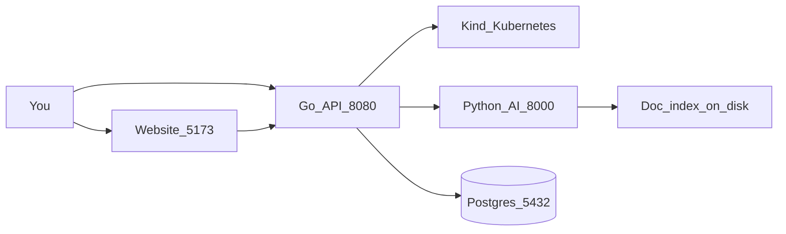

# KubeAssist — System Walkthrough (from scratch)

This document explains the **entire integrated project** so someone who has never opened the repo can understand what was built, why, and how the pieces talk to each other.

For **commands to start services**, use [INTEGRATION.md](INTEGRATION.md).  
For **why we chose each glue decision**, use [decision.md](decision.md) (S1–S10).  
AI-module decisions live in `Kubernetes-assistant/docs/decision.md` (D1–D15).

---

## Table of contents

1. [The everyday problem](#1-the-everyday-problem)
2. [What we built (big picture)](#2-what-we-built-big-picture)
3. [How folders are organized](#3-how-folders-are-organized)
4. [What the user goes through](#4-what-the-user-goes-through)
5. [What happens when you click “Run diagnosis”](#5-what-happens-when-you-click-run-diagnosis)
6. [Go functionality in detail](#6-go-functionality-in-detail)
7. [What Postgres is for](#7-what-postgres-is-for)
8. [RAG and the Python AI in extreme detail](#8-rag-and-the-python-ai-in-extreme-detail)
9. [How Go and the AI are connected](#9-how-go-and-the-ai-are-connected)
10. [Integration steps we actually took](#10-integration-steps-we-actually-took)
11. [Lab scenarios you can demo](#11-lab-scenarios-you-can-demo)
12. [Bugs we hit and how we fixed them](#12-bugs-we-hit-and-how-we-fixed-them)
13. [What is not done yet](#13-what-is-not-done-yet)
14. [One paragraph you can memorize](#14-one-paragraph-you-can-memorize)

---

## 1. The everyday problem

Companies run applications in **Kubernetes** (often shortened to “K8s”). Kubernetes is like a factory manager for software: it starts your app, restarts it if it dies, and spreads work across machines.

When something goes wrong, Kubernetes often shows a short, cryptic status, for example:

| Status you see | Everyday meaning |
| --- | --- |
| `CrashLoopBackOff` | The container keeps crashing and restarting |
| `ImagePullBackOff` | Kubernetes cannot download the app image |
| `OOMKilled` | The app used too much memory and was killed |
| `CreateContainerConfigError` | Missing ConfigMap/Secret or bad config reference |
| `FailedScheduling` | The pod cannot be placed on any node |

A human engineer then spends a long time:

1. Looking at the broken app (`kubectl describe`, events, logs)
2. Guessing the cause
3. Searching documentation for how to fix it

**KubeAssist** does that investigation path for you and returns a clear written report.

### What KubeAssist deliberately does *not* do

- It does **not** automatically change the cluster (no auto-fix, no running write commands for you).
- It does **not** send Secret *values* to the AI.
- The AI service **never** receives Kubernetes credentials (`kubeconfig`). Only Go holds those.

---

## 2. What we built (big picture)

Think of three workers and a filing cabinet:

| Everyday role | Piece in the project | Job |
| --- | --- | --- |
| Front desk | React website (Vite UI) | Pick namespace → pick pod → “Run diagnosis” |
| Detective | Go backend (`backend-go`) | Talk to Kubernetes, gather facts, **classify** the failure |
| Librarian + writer | Python AI (`ai-service`) | Look up matching docs (**RAG**), write the explanation |
| Filing cabinet | PostgreSQL | Remember past diagnoses (history) |
| Practice room | Kind cluster + lab manifests | Local Kubernetes with intentionally broken pods for demos |

### Who talks to whom

```text
You (browser or curl)
  → Website :5173  (optional; curl can hit Go directly)
       → Go API :8080
            → Kind / Kubernetes   (live facts)
            → Python AI :8000     (explanation + docs)
            → Postgres :5432      (optional history)
```

**Hard safety rule (trust boundary):**

- The browser talks **only** to Go.
- Go talks to Kubernetes and to the AI.
- The AI receives **JSON only** (a redacted “case file”). It never gets cluster keys.



### Ports cheat sheet

| Service | Port |
| --- | --- |
| Website (Vite) | 5173 |
| Go API | 8080 |
| Python AI | 8000 |
| Postgres | 5432 |

---

## 3. How folders are organized

There are **three source trees** plus an **integration hub**:

| Folder | What lives there |
| --- | --- |
| `Kubernetes-assistant` | Python AI service, shared JSON schemas (1.1.0), Kind lab YAML, AI docs |
| `backend-go` (Yashmit-k/KubeAssist) | Go collector, detectors, HTTP API, AI client, Postgres store |
| `KubeAssist-stack` | Glue: Docker Compose, UI, run scripts, this walkthrough |

### Junctions (Windows shortcuts, not copies)

Inside the stack hub:

```text
KubeAssist-stack/backend-go  →  ../backend-go
KubeAssist-stack/ai-service  →  ../Kubernetes-assistant/ai-service
KubeAssist-stack/schemas     →  ../Kubernetes-assistant/schemas
```

We did **not** merge the two GitHub remotes into one monorepo. The hub connects them without duplicating code (decisions **S1**, **S2**).

If junctions are missing on a new machine, recreate them with `scripts/link-modules.ps1`.

---

## 4. What the user goes through

### Once per machine (setup)

1. Install tools: Go, Docker Desktop, kubectl, Kind, Node.js  
2. Create Kind cluster (`kubeassist-dev`)  
3. Apply lab broken pods (namespace `kubeassist-lab`) and read-only RBAC  
4. `go mod tidy` / build the Go server once  
5. `npm install` in `KubeAssist-stack/frontend`  

Exact commands: [INTEGRATION.md](INTEGRATION.md).

### Every demo (four terminals)

1. **Compose:** Postgres + AI (`docker compose up -d postgres ai-service`)  
2. **Go:** `.\scripts\run-go.ps1`  
3. **Smoke:** health checks + optional curl troubleshoot  
4. **UI:** `npm run dev` → http://localhost:5173  

### UI journey

1. Open the site — cluster bar should show Go is healthy  
2. Choose a **namespace** (use `kubeassist-lab` for demos)  
3. See the **pod table** (phase, ready, restarts, waiting reason)  
4. Select a pod → optionally view logs  
5. Click **Run diagnosis**  
6. Read the report: summary, evidence, root cause, steps, verification commands, doc links  
7. Notice the **mode** badge (`mock_llm`, `full_rag`, or `detector_only_stub`)

The UI prefers a streaming endpoint when possible, and falls back to a normal POST. If you type a custom question or service name, it **forces POST** (see [SSE caveat](#sse-vs-post-important-detail)).

---

## 5. What happens when you click “Run diagnosis”

Follow one broken pod end to end.

### Step A — Request arrives at Go

`POST /api/pods/{namespace}/{pod}/troubleshoot`  
Optional body: `{ "question": "...", "serviceName": "..." }`

### Step B — Go collects facts (“crime scene”)

Go builds a **DiagnosticSnapshot**: a structured JSON case file about that pod (status, events, logs, owners, detector fields later, and so on). Caps keep payloads small (events, log lines/bytes).

### Step C — Go classifies with detectors

Deterministic rules set:

- `failureType` — the label (e.g. `CrashLoopBackOff`)  
- `evidence` — why Go believes that  
- `searchTerms` — keywords for doc search  

**The AI is not allowed to invent a different failure type.** It must echo Go’s type (architecture decision **D1**).

### Step D — Redaction

Secrets-looking strings are stripped before the snapshot leaves Go.

### Step E — Go calls Python

`POST http://127.0.0.1:8000/ai/troubleshoot`  
with `Authorization: Bearer <shared token>`.

### Step F — Python retrieves docs and writes the diagnosis

See [section 8](#8-rag-and-the-python-ai-in-extreme-detail).

### Step G — Response returns to you

A **DiagnosisResponse** (schema 1.1.0): issue summary, observed evidence, probable root cause, reasoning, confidence, resolution steps, verification commands, rollback guidance, documentation references, uncertainty notes, and `mode`.

### Step H — Optional save to Postgres

If the database is configured, Go stores the snapshot + diagnosis as an investigation record.

### If AI is down

Go still returns a useful minimal answer with `mode: "detector_only_stub"` — classification without the full AI write-up. That is intentional (**S8**).

---

## 6. Go functionality in detail

**Analogy:** Go is the detective who visits the crime scene, labels the case type, and only then asks the librarian for manuals.

Main entry points (under `backend-go/`):

| Concern | Where (typical) |
| --- | --- |
| HTTP routes | `internal/api/handlers.go` |
| Collect from cluster | `internal/collector/` |
| Classify failure | `internal/detect/detect.go` |
| Redact secrets | `internal/redact/` |
| Call AI | `internal/ai/client.go` |
| Save history | `internal/store/` |
| Snapshot / diagnosis types | `internal/model/` |
| Config / env | `internal/config/` |

### 6.1 Collector — two passes

**Pass 1 (always):**

- Pod status, conditions, container / init-container states, restart counts  
- Resource requests/limits, probe summaries  
- Events (capped, newest first)  
- Current logs (truncated); **previous** logs only if `restartCount > 0`  
- Owner chain summaries (Pod → ReplicaSet → Deployment)

**Pass 2 (when needed):**

- Services / endpoints when checking selector mismatches or when `serviceName` is provided  
- ConfigMap **names/keys** (not Secret values) for config errors  

Pending pods emphasize scheduling events; logs may be empty and marked unavailable.

### 6.2 Detectors — first match wins

Detectors run in **priority order**. The first matching rule becomes `failureType`. (This is not “vote for the most evidence.”)

Typical order (see `detect.go` for the live list):

1. `Evicted`  
2. `InitContainerFailure`  
3. `ImagePullBackOff` (includes waiting reason `ErrImagePull` in evidence; type stays `ImagePullBackOff`)  
4. `OOMKilled`  
5. `VolumeMountFailure`  
6. `CreateContainerConfigError`  
7. `FailedScheduling`  
8. `ProbeFailure` (liveness Unhealthy + probe config + restarts)  
9. `CrashLoopBackOff`  
10. `ReadinessFailure`  
11. Fallback: `Healthy` or `Unknown`  

**Pass-2 related:** `ServiceSelectorMismatch` when a Service has zero ready endpoints and selectors do not match the pod’s labels — even if the pod itself looks healthy.

Each hit returns confidence, evidence strings, and search terms for RAG.

### 6.3 Redaction

Before the snapshot is posted to Python, Go strips tokens, PEM blocks, and password-like strings so the AI never sees raw secrets.

### 6.4 AI client

- Base URL: `AI_BASE_URL` (default `http://127.0.0.1:8000`)  
- Auth: `Authorization: Bearer` + `AI_AUTH_TOKEN`  
- Retries once on retryable HTTP statuses (e.g. 429 / 5xx)  
- On persistent AI failure, the API surfaces an error such as `ai_service_error` (what you saw before the schemas mount fix)

### 6.5 SSE vs POST (important detail)

| Path | Notes |
| --- | --- |
| `POST .../troubleshoot` | Full path including pass-2 when needed; accepts `question` / `serviceName` |
| `GET .../troubleshoot/stream` | Emits stages: `collecting` → `detecting` → `retrieving` → `diagnosing` → `done`; **does not** apply request body the same way / may skip pass-2 |

The UI therefore **forces POST** when a question or service name is set.

---

## 7. What Postgres is for

**Short answer:** Postgres is a **filing cabinet for past investigations**. It is not the brain of the product.

### What it stores

After a successful troubleshoot (when `DATABASE_URL` is set), Go can save a row roughly like:

- namespace, pod name  
- snapshot JSON  
- diagnosis JSON  
- created timestamp  

Table name in the Go store: `investigations` (JSONB payloads). There are API routes to list/fetch investigations; the UI history view is still minimal.

### What it does *not* store

| Not in Postgres | Where it actually lives |
| --- | --- |
| Live Kubernetes state | The Kind / cluster API (queried fresh each time) |
| Documentation search vectors | Files under `ai-service/data/faiss/` (`vectors.npy`, `metadata.json`) |

### Do you need Postgres to diagnose?

**No.** Diagnosis needs Go + Kubernetes + (preferably) AI.  
Without Postgres you still get a full diagnosis; you just do not keep searchable history.

Compose starts Postgres so the “full stack” story is complete for demos.

---

## 8. RAG and the Python AI in extreme detail

**Analogy:** Go hands the librarian a labeled case file. The librarian pulls the right manuals off the shelf, then writes (or fills in) a how-to guide.

### 8.1 What “RAG” means in one sentence

**RAG (Retrieval-Augmented Generation)** = first **look up** relevant documentation, then **write** an answer using that material — instead of inventing Kubernetes advice from thin air.

### 8.2 Building the private library (offline, once)

1. Curated Markdown excerpts live in `ai-service/data/raw_docs/` (with frontmatter: title, URL, failure tags, Kubernetes version hints, …).  
2. `scripts/build_index.py` (and `app/rag/index.py`) chunk the text (paragraph packing, roughly ~3200 characters with overlap).  
3. Each chunk is turned into a numeric vector and stored under `ai-service/data/faiss/`:
   - `vectors.npy` — the matrix of vectors  
   - `metadata.json` — titles, URLs, snippets, tags  
   - `manifest.json` — records backend `"hashed-ip"`  

**Honesty for interviews / demos:**  
The folder is named `faiss` for historical reasons. The **current MVP does not use the FAISS library** and does not use sentence-transformers / OpenAI embeddings by default. Retrieval is **hashed n-gram vectors + NumPy inner product**.

### 8.3 How “embedding” works here (no neural net required)

For a piece of text the embedder (`app/rag/embed.py`) roughly:

1. Splits into words (**unigrams**) and adjacent pairs (**bigrams**)  
2. Hashes each into one of **384** buckets (hashing trick), with a ±1 sign  
3. **L2-normalizes** the resulting 384-number vector  

A **query** (failure type + Go’s search terms + optional user question) gets the **same treatment**. Similar wording tends to land in similar bucket patterns, so the **inner product** score is high when texts are related.

### 8.4 Retrieval at request time (`app/rag/retrieve.py`)

1. Load vectors + metadata if needed  
2. Embed the query  
3. Score: `scores = vectors @ query`  
4. Soft-boost chunks whose `failure_tags` include this `failureType`  
5. Prefer chunks whose documented Kubernetes version matches the cluster’s major.minor when available  
6. Return top‑k hits (default `RAG_TOP_K=5`) with title, URL, section, snippet, score  

### 8.5 Writing the diagnosis (`app/pipeline/troubleshoot.py`)

```text
snapshot in
  → retrieve docs
  → format evidence
  → either mock stub OR live LLM JSON
  → force failureType = Go’s type
  → keep citations only from retrieved URLs
  → hybrid confidence score
  → validate against diagnosis schema + grounding checks
  → diagnosis out
```

#### Mock mode (default)

- Env: `LLM_MOCK=true` **or** empty `LLM_API_KEY`  
- No billable API call  
- A **playbook stub** fills a schema-valid diagnosis and attaches retrieved citations  
- Response `mode`: `mock_llm`  
- Why: demos, CI, and local work without a key (**D9**)

#### Live LLM mode

- `LLM_MOCK=false` and a real `LLM_API_KEY`  
- OpenAI-compatible chat completions returning JSON  
- Must pass validators; citations restricted to retrieved URLs  
- On failure → fall back to stub (`mock_llm`)  
- Success → `mode`: `full_rag`

### 8.6 Confidence (hybrid)

Rough blend (decision **D6**):

- ~50% detector confidence from Go  
- ~30% retrieval score quality  
- ~20% LLM self-score (when present)  

Unknown failures / empty logs are capped lower so we do not sound overconfident.

### 8.7 Schema validation

Incoming snapshot and outgoing diagnosis must match shared JSON Schema **1.1.0**:

- `schemas/diagnostic-snapshot.schema.json`  
- `schemas/diagnosis.schema.json`  

In Docker, `paths.py` resolves schemas as `/schemas` (parent of `/app`). That is why the compose volume `./schemas:/schemas:ro` matters (**S10**).

AI HTTP surface (`ai-service`):

- `GET /health` — includes whether the index is ready  
- `POST /ai/troubleshoot` — bearer auth + full pipeline  

---

## 9. How Go and the AI are connected

### Shared contract

Both sides agree on JSON Schema **1.1.0**. Go fills the snapshot (including `detector`). Python returns a diagnosis that **echoes** `failureType`.

### Auth token mapping (names differ, values must match)

| Side | Environment variable | Default (dev) |
| --- | --- | --- |
| Python AI | `AI_SHARED_TOKEN` | `dev-shared-token-change-me` |
| Go | `AI_AUTH_TOKEN` | same value |

Mismatch → AI 401 → Go errors or degraded behavior.

### What each side owns

| Owns cluster credentials | Owns doc index | Owns UI traffic |
| --- | --- | --- |
| Go only | Python only | Go only (UI → Go) |

---

## 10. Integration steps we actually took

This is the story of how the pieces became one runnable product (stack decisions **S1–S10**):

| Step | Decision | In plain words |
| --- | --- | --- |
| 1 | **S1** | Created `KubeAssist-stack` as a hub instead of merging Git histories |
| 2 | **S2** | Linked modules with Windows junctions (no duplicate source trees) |
| 3 | **S3** | UI talks only to Go; Go talks to AI + cluster |
| 4 | **S4** | Documented token name mapping; aligned default values |
| 5 | **S5** | Run Go on the host; run AI + Postgres in Compose (Kind-friendly on Windows) |
| 6 | **S6** | Kept schema 1.1.0 unchanged for glue |
| 7 | **S7** | Built Vite + React + TypeScript UI (list pods → diagnose → show report) |
| 8 | **S8** | Treated `detector_only_stub` as a feature when AI is down |
| 9 | **S9** | Explicitly deferred neural FAISS, LLM-as-judge, monorepo merge, auto-remediation |
| 10 | **S10** | Mounted `./schemas` into the AI container after live E2E hit HTTP 500 |

Also verified: Go modules build on Windows; AI health returns `indexReady: true`; troubleshoot against `kubeassist-lab` returns a full diagnosis in mock mode.

---

## 11. Lab scenarios you can demo

Broken practice apps (AI repo `k8s/lab/` and/or Go lab examples) typically include:

| Lab idea | Expected `failureType` (approx.) |
| --- | --- |
| Healthy control | `Healthy` |
| App that exits | `CrashLoopBackOff` |
| Bad liveness probe | `ProbeFailure` |
| Bad image name | `ImagePullBackOff` |
| Tiny memory limit | `OOMKilled` |
| Missing ConfigMap | `CreateContainerConfigError` |
| Impossible scheduling | `FailedScheduling` |
| Service selector mismatch | `ServiceSelectorMismatch` (pod may look healthy) |

Always diagnose in the namespace where the lab was applied (commonly **`kubeassist-lab`**, not `default`).

---

## 12. Bugs we hit and how we fixed them

| Symptom | Cause | Fix |
| --- | --- | --- |
| `pod_not_found` | Troubleshoot used wrong namespace | Use `kubeassist-lab` (or the ns where labs exist) |
| `ai_service_error` / retryable HTTP 500 | AI container missing `/schemas` → `FileNotFoundError` | Compose volume `./schemas:/schemas:ro`, recreate AI container (**S10**) |
| Nested `COPY schemas` failed in Docker build | Docker Desktop on Windows does not follow nested junctions in build context | Do not COPY schemas in image; mount at runtime |
| Empty / wrong diagnosis mode | Token mismatch or AI stopped | Align `AI_AUTH_TOKEN` ↔ `AI_SHARED_TOKEN`; check `AI_BASE_URL` |

---

## 13. What is not done yet

Honest list (do not oversell in interviews):

- Neural embeddings / real FAISS library / BM25 hybrid retrieval  
- LLM-as-judge groundedness loop  
- Schema 1.2 “recollect” handshake  
- Full investigation-history UI  
- SSE path parity with POST (pass-2 / body)  
- Portable clone via git submodules instead of junctions  
- Auto-remediation (intentionally out of scope)  
- Exhaustive live verification of every golden note against Kind  

What **is** enough for a strong demo today: Kind lab + Go classify + Python RAG (hashed index) + mock or live LLM + React UI + optional Postgres history + shared schemas 1.1.0.

---

## 14. One paragraph you can memorize

> KubeAssist helps engineers understand broken Kubernetes pods. A Go service collects live facts from the cluster and classifies the failure with deterministic rules. It sends a redacted case file to a Python service that retrieves relevant Kubernetes documentation (RAG) and writes a structured diagnosis. A small web UI talks only to Go. Postgres optionally stores past investigations. The AI never gets cluster credentials and is not allowed to invent a different failure type.

### 60-second pitch

“We built an evidence-first Kubernetes copilot. Go is the detective; Python is the librarian; the UI is the front desk. Classification is rules-based; explanation is retrieval-augmented; nothing auto-writes to the cluster.”

### Deep-dive prompts you should be ready for

- Why doesn’t the LLM choose `failureType`?  
- Why is the index folder named `faiss` if you don’t use FAISS?  
- What is Postgres for vs the vector files?  
- What happens if the AI is down?  
- Why mount schemas into Docker?  

---

## Related documents

| Doc | Use it for |
| --- | --- |
| [INTEGRATION.md](INTEGRATION.md) | Run / smoke commands |
| [decision.md](decision.md) | Stack decisions S1–S10 |
| `Kubernetes-assistant/docs/ARCHITECTURE.md` | Correctness rules, collector caps, taxonomy |
| `Kubernetes-assistant/docs/decision.md` | AI/RAG decisions D1–D15 |
| `Kubernetes-assistant/docs/projectprogress.md` | Chronological progress log |
| `Kubernetes-assistant/docs/SYSTEM_STATUS_AND_ROADMAP.md` | Status + future phases |
